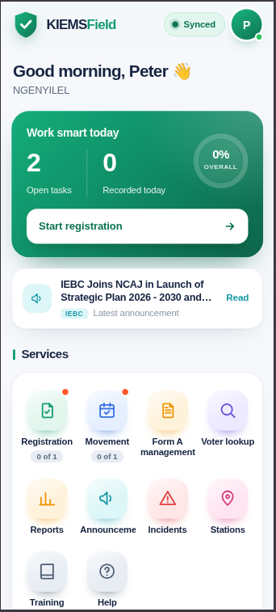
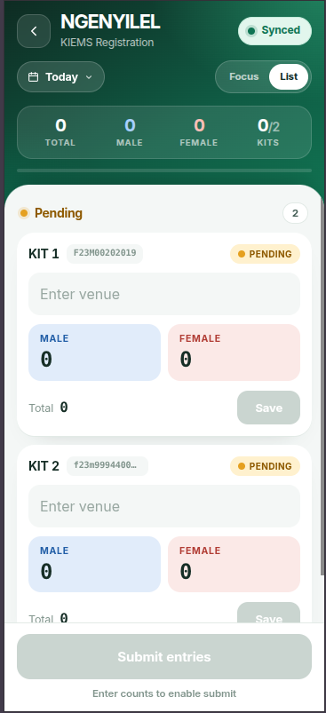
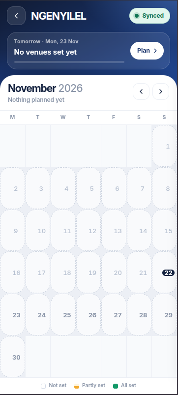
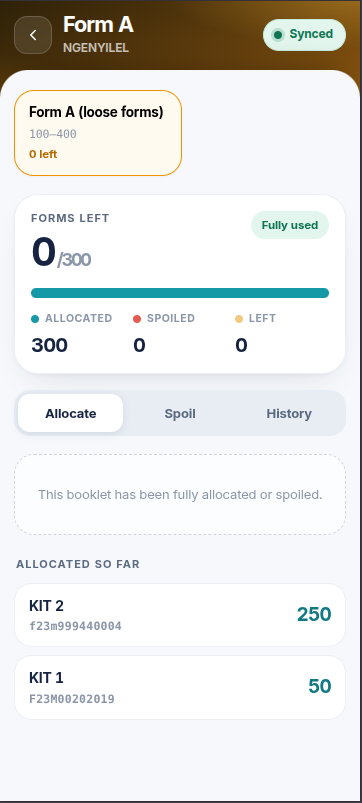
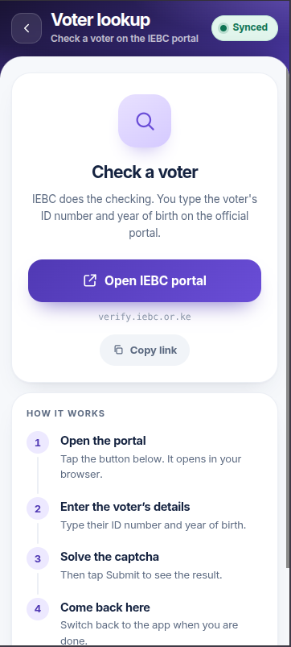
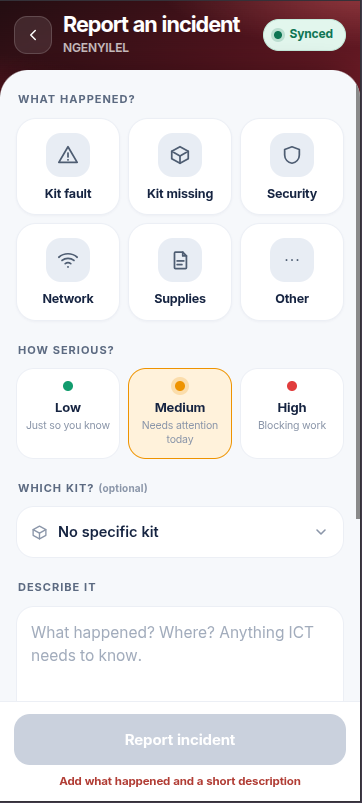

# KIEMS Field PWA

Offline-first Svelte 5 PWA used by IEBC VRAs in the field. Talks to the
**KIEMS Backend** (separate Django project) over JSON APIs.

Everything works without a network. Writes queue in IndexedDB and drain
automatically on reconnect with end-to-end idempotency.

---

## Table of contents

- [What it does](#what-it-does)
- [Tech stack](#tech-stack)
- [Architecture](#architecture)
- [Repository layout](#repository-layout)
- [Offline sync model](#offline-sync-model)
- [Prerequisites](#prerequisites)
- [Setup](#setup)
- [Environment variables](#environment-variables)
- [Running](#running)
- [Building for production](#building-for-production)
- [Adding a new feature](#adding-a-new-feature)
- [Service worker](#service-worker)
- [Debugging](#debugging)
- [Deployment](#deployment)
- [Troubleshooting](#troubleshooting)
- [Contributing](#contributing)
- [License](#license)

---

## What it does

| Screen | Purpose |
|---|---|
| **Home** | Greeting, KPI tiles, service grid, latest announcement |
| **Registration** | Daily voter-count submission per kit |
| **Movement** | Tomorrow's venue schedule per kit |
| **Form A** | Allocate booklets to kits + report spoiled serials |
| **Voter Lookup** | Proxy to IEBC portal for voter verification |
| **Reports** | Ward-level daily stats |
| **Announcements** | IEBC + ICT news feed |
| **Incidents** | Report kit faults, security, network, supplies |
| **Training / Help** | Markdown docs from the backend |
| **Stations** | Search registration centres |
| **Profile / System** | Device binding, sync queue, diagnostics |

---
## Screenshots

<table>
  <tr>
    <td align="center"><br><sub>Home</sub></td>
    <td align="center"><br><sub>Registration</sub></td>
    <td align="center"><br><sub>Movement</sub></td>
  </tr>
  <tr>
    <td align="center"><br><sub>Form A</sub></td>
    <td align="center"><br><sub>Voter Lookup</sub></td>
    <td align="center"><br><sub>Incidents</sub></td>
  </tr>
</table>

## Tech stack

| Component | Version | Purpose |
|---|---|---|
| Node.js | 20+ | Build toolchain |
| Vite | 5+ | Bundler + dev server |
| Svelte | 5.x | UI framework |
| vite-plugin-pwa | 0.20+ | Service worker + manifest |
| IndexedDB (custom wrapper) | — | Offline queue + cache |

---

## Architecture

```
┌──────────────────────────────┐
│ App.svelte (router)          │
│ ├── routes/                  │  ← page components
│ ├── components/              │  ← shared UI
│ └── lib/                     │
│     ├── core/                │  ← offline engine
│     │   ├── db.js            │  IndexedDB wrapper
│     │   ├── queue.js         │  Op queue + backoff
│     │   ├── ops.js           │  Op kinds + executor
│     │   ├── sync.js          │  Leader election + drain
│     │   ├── session.js       │  Current VRA + ward
│     │   └── ui.js            │  Sheet open/close stores
│     ├── services/            │  ← one folder per feature
│     │   ├── forms-tracking/
│     │   ├── incidents/
│     │   └── ...
│     ├── api.js               │  fetch wrapper
│     └── config.js            │  apiUrl, constants
└──────────────────────────────┘
              │
              │ HTTPS (JSON)
              ▼
    KIEMS Backend (separate repo)
```

---

## Repository layout

```
iebc-pwa/
├── src/
│   ├── App.svelte              # Router + boot sequence
│   ├── main.js                 # Entry point
│   ├── routes/                 # Page components
│   │   ├── HomePage.svelte
│   │   ├── EntryPage.svelte
│   │   ├── MovementPage.svelte
│   │   ├── FormAManagementPage.svelte
│   │   ├── VoterLookupPage.svelte
│   │   ├── ReportsPage.svelte
│   │   ├── AnnouncementsPage.svelte
│   │   ├── IncidentsPage.svelte
│   │   ├── TrainingPage.svelte
│   │   ├── HelpPage.svelte
│   │   └── StationsPage.svelte
│   │
│   ├── components/             # Shared UI
│   │   ├── SyncBadge.svelte
│   │   ├── PageTransition.svelte
│   │   ├── ServiceTile.svelte
│   │   ├── ProfileSheet.svelte
│   │   ├── UpdateBanner.svelte
│   │   └── BindModal.svelte
│   │
│   └── lib/
│       ├── core/
│       │   ├── db.js           # IndexedDB: Cache + Queue stores
│       │   ├── queue.js        # enqueue, markSuccess, markFailure
│       │   ├── ops.js          # OP_KINDS registry + executeOp
│       │   ├── sync.js         # Leader election + drain loop
│       │   ├── session.js      # { status, vra, ward, fingerprint }
│       │   ├── sw-register.js  # SW registration + background sync
│       │   ├── migrate.js      # One-shot legacy storage migration
│       │   └── ui.js           # UI stores (sheets, toasts)
│       │
│       ├── services/           # One folder per feature
│       │   ├── forms-tracking/
│       │   │   ├── FormAManagementPage.svelte
│       │   │   ├── queue.js    # queueAction shim
│       │   │   └── index.js    # formAService descriptor
│       │   ├── incidents/
│       │   ├── announcements/
│       │   ├── reports/
│       │   ├── stations/
│       │   ├── reference/
│       │   └── voter-lookup/
│       │
│       ├── api.js              # apiFetch wrapper
│       └── config.js           # apiUrl, constants
│
├── public/
│   ├── icons/
│   ├── favicon.svg
│   └── apple-touch-icon.png
│
├── index.html
├── vite.config.js
├── svelte.config.js
├── package.json
└── README.md
```

---

## Offline sync model

### Layers

1. **IndexedDB** — two stores:
   - `Cache` — HTTP response cache (keyed by URL)
   - `Queue` — pending ops
2. **Op kinds** (`lib/core/ops.js`) — one entry per API call. Each defines
   `buildRequest(payload)` and `interpretResponse(data)`.
3. **Executor** (`executeOp`) — attaches CSRF + `Idempotency-Key: op.id`,
   runs `fetch`, classifies response as `ok` / `transient` / `auth`.
4. **Drain loop** (`sync.js`) — leader-elected across tabs; runs on:
   - `online` event
   - `visibilitychange → visible`
   - 30s periodic tick
   - SW `drain-queue` message
5. **Backoff** (`queue.js`) — exponential with jitter, max 10 attempts,
   then `gaveup`.

### Coalescing

Some op kinds merge if re-enqueued while still queued:

| Op kind | Coalesce key |
|---|---|
| `entry.submit` | `(fingerprint, date, kit_id set)` |
| `movement.save` | `(ward_id, schedule_date)` |
| `form_a.allocate` | `(receipt_id, kit_id)` |
| `form_a.spoil` | **No** — each serial is distinct |
| `incident.submit` | **No** |

### Idempotency

- Client generates `op.id` (UUID v4) → `Idempotency-Key` header.
- Backend stores `(key, scope) → response`.
- Replays return the stored body with `replayed: true`.
- Safe to retry any write, any number of times.

### Op kinds currently supported

| Kind | Endpoint | Priority | Coalesce |
|---|---|---|---|
| `entry.submit` | `POST /kiems/submit-entries/` | 10 | Yes |
| `movement.save` | `POST /movement/save/` | 10 | Yes |
| `verify.tally` | `POST /api/verify-tally/` | 5 | Yes |
| `incident.submit` | `POST /api/incidents/` | 1 | No |
| `form_a.spoil` | `POST /api/form-a/report-spoil/` | 4 | No |
| `form_a.allocate` | `POST /api/form-a/allocate/` | 5 | Yes |
| `form_a.deallocate` | `POST /api/form-a/deallocate/` | 5 | No |

Priority: lower number drains first. Incidents go ahead of everything else.

### Session lifecycle

`lib/core/session.js` exports a Svelte store:

```js
{
  status: 'loading' | 'unbound' | 'bound' | 'error',
  vra: { id, name, ward_id, ... } | null,
  ward: { id, name, ... } | null,
  constituency: { id, name } | null,
  fingerprint: string,
  error: string,
}
```

Boot sequence in `App.svelte::onMount`:

1. `registerSW()` — arm the service worker
2. `migrateLegacyStorage()` — one-shot migration from older cache formats
3. `restoreSession()` — paint from IndexedDB immediately (no network)
4. `initSync()` — start the drain loop
5. `apiFetch('/api/csrf/')` — seed CSRF cookie
6. `resolveSession()` — refresh against the backend in the background

The session survives reloads — no re-binding required unless the device is
revoked server-side.

---

## Prerequisites

- Node.js 20+
- The **KIEMS Backend** running (locally at `http://127.0.0.1:8000`)

Verify:

```bash
node --version   # v20.x or higher
npm --version    # 10.x or higher

curl http://127.0.0.1:8000/api/csrf/   # { "ok": true, "csrfToken": "..." }
```

If the second command fails, start the backend first.

---

## Setup

```bash
git clone <repo-url>
cd iebc-pwa

npm install
```

Create `.env.local` (see Environment variables).

---

## Environment variables

Vite reads from `.env`, `.env.local`, `.env.[mode]`.

```bash
# .env.local
VITE_API_BASE=http://127.0.0.1:8000
VITE_APP_VERSION=dev
```

`src/lib/config.js`:

```js
export const apiUrl = (path) => `${import.meta.env.VITE_API_BASE || ''}/api${path}`;
export const appVersion = import.meta.env.VITE_APP_VERSION || 'dev';
```

In dev, Vite proxies `/api`, `/kiems`, `/movement`, `/static`, `/media`,
`/iebc-proxy` to the Django dev server (see `vite.config.js`), so
`VITE_API_BASE` can stay empty locally.

For production builds, set `VITE_API_BASE` to the deployed backend origin.

---

## Running

```bash
npm run dev
```

Served at <http://localhost:5173/>.

The dev server requires the Django backend running at `http://127.0.0.1:8000`.
Start it first:

```bash
# In the backend repo
python manage.py runserver 0.0.0.0:8000
```

### First-time device binding

1. Open <http://localhost:5173/> in a fresh browser
2. Follow the binding prompt → select constituency + ward
3. Device is auto-authorized on the backend
4. You're now logged in as the VRA for that ward

### Available scripts

| Script | Purpose |
|---|---|
| `npm run dev` | Start dev server on port 5173 |
| `npm run build` | Production build → `dist/` |
| `npm run preview` | Serve the built output locally (SW enabled) |
| `npm run check` | Svelte type + a11y check |

---

## Building for production

```bash
npm run build
```

Output → `dist/`. Serve with any static host (Nginx, Vercel, Netlify, S3+CDN).

### Serve from Django (same origin)

Copy `dist/` into Django's `static/pwa/` and add a catch-all route in
`kiems/urls.py` for PWA paths. This avoids CORS and keeps cookies same-origin.

### Serve from separate host

Point `VITE_API_BASE` at the backend origin at build time:

```bash
VITE_API_BASE=https://api.kiems.example.com npm run build
```

Configure CORS on the backend (`django-cors-headers`) for the PWA origin.

---

## Adding a new feature

Every feature follows the same five-step pattern.

### 1. Add the API op kind

`src/lib/core/ops.js`:

```js
export const OP_KINDS = {
  // ...
  'widget.create': {
    priority: 8,
    buildRequest(payload) {
      return {
        url: apiUrl('/widgets/'),
        init: {
          method: 'POST',
          headers: { 'Content-Type': 'application/json' },
          body: JSON.stringify(payload),
          credentials: 'include',
        },
      };
    },
    interpretResponse(data) {
      if (data?.ok) return { ok: true, id: data.widget_id };
      return { ok: false, error: data?.error || 'Widget failed' };
    },
  },
};
```

### 2. Add a service descriptor

`src/lib/services/widgets/index.js`:

```js
export const widgetService = {
  id: 'widgets',
  label: 'Widgets',
  icon: 'box',
  tone: 'purple',
  live: true,
  hint: 'Manage widgets',
};
```

### 3. Add the queue shim (if the op is write-heavy)

`src/lib/services/widgets/queue.js`:

```js
import { enqueue } from '$lib/core/queue.js';
import { askServiceWorkerToDrain } from '$lib/core/sync.js';

export async function queueAction(scope, body) {
  const op = await enqueue(scope, body);
  askServiceWorkerToDrain();
  return op;
}
```

### 4. Build the screen

`src/lib/services/widgets/WidgetsPage.svelte`:

```svelte
<script>
  import { createEventDispatcher } from 'svelte';
  import { session } from '$lib/session.js';
  import { apiFetch } from '$lib/api.js';
  import { queueAction } from './queue.js';

  const dispatch = createEventDispatcher();
  // ...
</script>
```

### 5. Wire into the router

`src/App.svelte`:

```svelte
import WidgetsPage from './lib/services/widgets/WidgetsPage.svelte';

const ROUTES = [..., 'widgets', ...];
const PATH_TO_ROUTE = { ..., '/widgets': 'widgets' };

{#if route === 'widgets'}
  <WidgetsPage on:back={() => backToHome('widgets')} />
```

Register the tile in `HomePage.svelte`:

```js
import { widgetService } from '$lib/services/widgets/index.js';
$: SERVICES = [..., { ...widgetService, live: true }, ...];
```

That's it — the tile, the route, the offline queue, and idempotency all work
out of the box.

### Icon keys

`ICONS` in `HomePage.svelte` uses camelCase keys (`fileText`, `clipboard`,
`megaphone`, `shield`, ...). If your service descriptor's `icon` uses a
kebab-case name like `'file-text'`, the tile renders blank. Match them:

```js
// service descriptor
icon: 'fileText',     // ← matches ICONS.fileText
```

Or add a quoted key to `ICONS`: `'file-text': [...]`.

---

## Service worker

Managed by `vite-plugin-pwa`. Two strategies are possible in `vite.config.js`.

### `generateSW` (default, recommended)

```js
VitePWA({
  registerType: 'prompt',
  workbox: {
    globPatterns: ['**/*.{js,css,html,svg,png,woff2,webp}'],
    navigateFallback: 'index.html',
    navigateFallbackDenylist: [/^\/api\//, /^\/kiems\//, /^\/movement\//],
  },
});
```

No `sw.js` to maintain. The plugin generates and injects it.

### `injectManifest` (when you need custom SW logic)

Set `strategies: 'injectManifest'` and provide `src/sw.js` with
`self.__WB_MANIFEST` for precaching. Needed for:

- Custom push notification handlers
- Background Sync API usage
- Per-route custom caching strategies

**Important:** with `injectManifest`, the plugin reads `src/sw.js` at build
time. If the file is missing you'll see:

```
ENOENT: no such file or directory, open '.../src/sw.js'
```

The fix is either to create the file or switch to `generateSW`.

### Dev mode

SW is **disabled** in `npm run dev` by default (see `sw-register.js:26`).
To test SW behavior:

```bash
npm run build
npm run preview
```

### Clearing the SW cache

If you see stale content:

1. Chrome DevTools → **Application** → **Service Workers** → **Unregister**
2. **Application** → **Storage** → **Clear site data**
3. Hard reload (Ctrl+Shift+R)

Or from terminal:

```bash
rm -rf node_modules/.vite dist
npm run dev
```

---

## Debugging

### Sync queue

Open DevTools console:

```js
// In the running app:
const { snapshot } = await import('/src/lib/core/queue.js');
console.log(await snapshot());
```

Returns:

```js
{
  online: true,
  pending: 3,
  retrying: 1,
  gaveup: 0,
  lastSync: 1732278000000,
  ops: [/* all queued ops */],
}
```

### Force a drain

```js
const { drainQueue } = await import('/src/lib/core/sync.js');
await drainQueue();
```

### Retry / discard individual ops

```js
const { retryOp, discardOp } = await import('/src/lib/core/queue.js');
await retryOp('op-id-from-snapshot');
await discardOp('gaveup-op-id');
```

### Inspect IndexedDB

DevTools → Application → IndexedDB → `iebc-db` → tables `Cache`, `Queue`,
`OpLog`, `Meta`.

### Tail the backend log

The PWA's requests show in the Django terminal:

```
[20/Nov/2026 14:57:31] "POST /kiems/submit-entries/ HTTP/1.1" 200
[20/Nov/2026 14:57:32] "GET /api/stats/day/?fingerprint=... HTTP/1.1" 200
```

### Common Svelte warnings

`a11y_click_events_have_key_events` — a `<div>` with `on:click` needs a
keyboard handler or `role="presentation"`.

`a11y_no_noninteractive_element_to_interactive_role` — `<nav role="tablist">`
should be `<div role="tablist">`.

`Cannot access 'X' before initialization` — a top-level `let` calls a helper
declared later. Move helper functions (`const pad = ...`,
`function todayIso() {...}`) above any `let` that uses them.

---

## Deployment

### Static host (Netlify / Vercel / S3+CDN)

```bash
VITE_API_BASE=https://api.kiems.example.com npm run build
# Deploy dist/
```

Set `Content-Type: text/javascript` for `*.js`; caching headers:

```
/sw.js           → max-age=0, must-revalidate
/index.html      → max-age=0, must-revalidate
/assets/*        → max-age=31536000, immutable
```

The hashed `/assets/*` are content-addressed — safe to cache forever.

### Same-origin with Django

Copy `dist/` to `kiems/static/pwa/` and add a template view in Django that
serves `index.html`. Best for cookie-based auth without CORS.

### PWA install prompt

The manifest in `vite.config.js` defines icons, theme color, and display
mode. Users get an "Install" prompt on supported browsers after the second
visit with a working service worker.

To customise, edit `VitePWA.manifest` in `vite.config.js`.

---

## Troubleshooting

### White screen on load

1. Open DevTools **Console** — a JS error is blocking render
2. Common: stale SW cache — see [Clearing the SW cache](#clearing-the-sw-cache)
3. If the error is `Cannot resolve import` — a file moved; check the import
   path (use `$lib/...` for anything under `src/lib/`)

### `ENOENT: no such file or directory, open '.../src/sw.js'`

You're on `strategies: 'injectManifest'` but `src/sw.js` doesn't exist.
Either:

- Create `src/sw.js` with `precacheAndRoute(self.__WB_MANIFEST)` (and install
  the workbox packages), or
- Switch `vite.config.js` to the default `generateSW` strategy (remove
  `strategies`, `srcDir`, `filename`; rename `injectManifest: {...}` to
  `workbox: {...}`)

### "Cannot access 'X' before initialization"

Svelte 5 top-level `let` initializers run in source order. Move helper
functions (`const pad = ...`, `function todayIso() {...}`) above any `let`
that calls them.

### Requests fail with 404

Check the Django log. If the backend log shows the URL 404'ing, the route
isn't registered there — add it to `api/urls.py` or `kiems/urls.py` in the
backend project.

### Requests fail with 403 "Device not authorized"

Device needs to be burned (`is_burned=True`) in the backend. Ask the ICT
officer to authorize it via `/ict/devices/`.

### Offline ops never drain

1. Check console: `navigator.onLine` → should be `true`
2. `drainQueue()` manually (see Debugging)
3. Check `Queue` table in IndexedDB for `gaveup` rows
4. Backend might be down — `curl http://127.0.0.1:8000/api/csrf/`

### `form_a.spoil` returns 409 "Serial not in range"

The serial the VRA typed is outside the receipt's `serial_start`–`serial_end`.
The range hint in the UI shows the valid window; the backend enforces it.

### `form_a.allocate` returns 409 "Only N forms available"

The receipt is over-committed. Check `/ict/forms/<uuid>/` on the backend for
the current balance.

### Icon missing on the service tile

The `icon` field in the service descriptor doesn't match any key in
`ICONS` (in `HomePage.svelte`). Fix by matching them — either change the
descriptor to use a camelCase key, or add a quoted key to `ICONS`.

### Clicking a service tile does nothing

The router in `App.svelte` doesn't have a branch for that service id. Check:

```bash
grep -n "route ===" src/App.svelte
```

Add a branch for the new id (see [Adding a new feature](#adding-a-new-feature)).

---

## Contributing

1. Fork the repo.
2. Create a feature branch: `git checkout -b feature/my-thing`
3. Commit with conventional prefixes: `feat:`, `fix:`, `chore:`, `docs:`
4. Push and open a PR against `main`.
5. Ensure `npm run check` passes before requesting review.

### Commit style

```
feat(form-a): allocate receipts to kits
fix(sync): prevent duplicate queue drains
docs(readme): add troubleshooting section
```

### Code style

- `prettier` for formatting
- `eslint` for lint rules
- `svelte-check` for Svelte type + a11y checks

Run all three before committing:

```bash
npx prettier --write src/
npx eslint src/
npm run check
```

---

## License

MIT License — see [LICENSE](./LICENSE) for the full text.

Copyright (c) 2026 wayne-alex
Permission is hereby granted, free of charge, to any person obtaining a copy
of this software and associated documentation files (the "Software"), to deal
in the Software without restriction, including without limitation the rights
to use, copy, modify, merge, publish, distribute, sublicense, and/or sell
copies of the Software, and to permit persons to whom the Software is
furnished to do so, subject to the following conditions:

The above copyright notice and this permission notice shall be included in
all copies or substantial portions of the Software.

THE SOFTWARE IS PROVIDED "AS IS", WITHOUT WARRANTY OF ANY KIND, EXPRESS OR
IMPLIED, INCLUDING BUT NOT LIMITED TO THE WARRANTIES OF MERCHANTABILITY,
FITNESS FOR A PARTICULAR PURPOSE AND NONINFRINGEMENT. IN NO EVENT SHALL THE
AUTHORS OR COPYRIGHT HOLDERS BE LIABLE FOR ANY CLAIM, DAMAGES OR OTHER
LIABILITY, WHETHER IN AN ACTION OF CONTRACT, TORT OR OTHERWISE, ARISING FROM,
OUT OF OR IN CONNECTION WITH THE SOFTWARE OR THE USE OR OTHER DEALINGS IN THE
SOFTWARE.